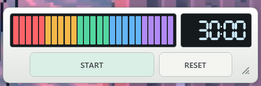
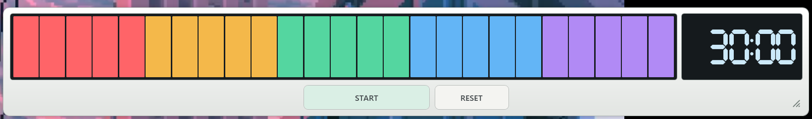

# TokiStrip

[日本語](README.md)

TokiStrip is a Windows desktop countdown timer. It shows time remaining as both a **25-segment color bar** and a digital readout, so you can check it at a glance while you work.



## Download

1. Open [Releases](../../releases/latest) and download `TokiStrip-v1.0.0-win-x64.zip` under **Assets**.
2. Extract the ZIP and open `TokiStrip.exe`.

The download targets Windows x64 and includes .NET.

## How to use

- **Set the time** — While the timer is stopped, drag left or right on the bar, or scroll the mouse wheel over it. Set any whole number of minutes from 1 to 120.
- **START / STOP** — Start, pause, or resume the timer. The alarm repeats until you press STOP, which silences it and returns the timer to its set duration.
- **RESET** — Return to the set duration and silence the alarm if it is ringing.
- **Resize and pin** — Drag the bottom-right grip to resize. The right-click menu offers three size presets, an always-on-top toggle, and a quick guide.

The app restores your set duration and the last saved window size and position the next time you open it.



## Run from source

Requires Windows and the .NET 9 SDK. Run this from the repository root.

```powershell
dotnet run --project VisualBarTimer.csproj
```

## License

[MIT License](LICENSE)
