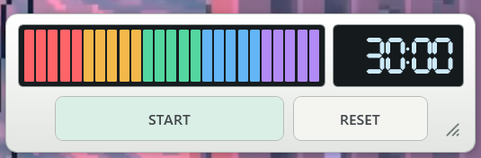
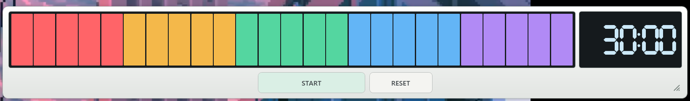

# TokiStrip

[English](README.en.md)

TokiStrip は、残り時間を **25目盛りのカラーバー**と数字で表示する Windows 用のデスクトップタイマーです。画面の端に置いて、作業中に残り時間をひと目で確認できます。



## ダウンロード

1. [Releases](../../releases/latest) の **Assets** から `TokiStrip-v1.0.0-win-x64.zip` をダウンロードします。
2. ZIP を展開して `TokiStrip.exe` を開きます。

対象は Windows x64 です。配布 ZIP には .NET が同梱されています。

## 使い方

- **時間設定** — 停止中にバーを左右にドラッグするか、バーの上でマウスホイールを回します。1分刻みで、1〜120分に設定できます。
- **START / STOP** — 開始・一時停止・再開を切り替えます。アラームは繰り返し鳴り、STOP を押すと消音して設定時間に戻ります。
- **RESET** — 設定時間に戻します。アラームが鳴っていれば止まります。
- **サイズと前面固定** — 右下のグリップで伸縮できます。右クリックメニューにはサイズの3段階切り替え、前面固定、使い方があります。

設定した時間と、閉じたときのウィンドウのサイズ・位置は次の起動時に復元されます。



## ソースから起動

Windows と .NET 9 SDK が必要です。リポジトリのルートで実行してください。

```powershell
dotnet run --project VisualBarTimer.csproj
```

## ライセンス

[MIT License](LICENSE)
